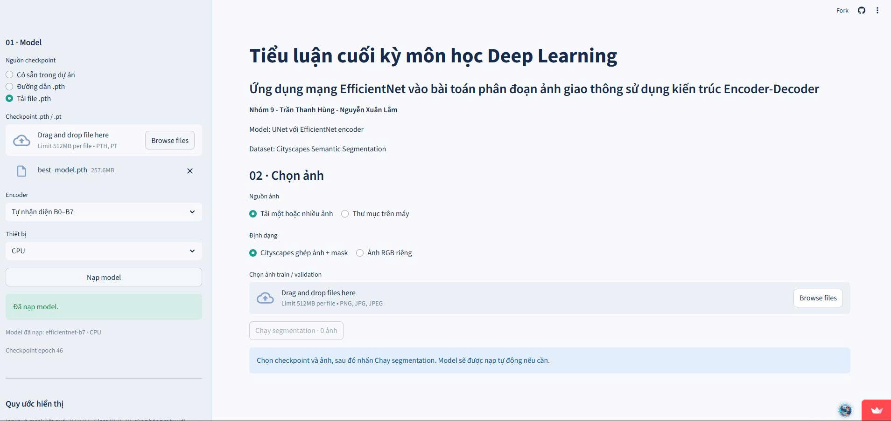
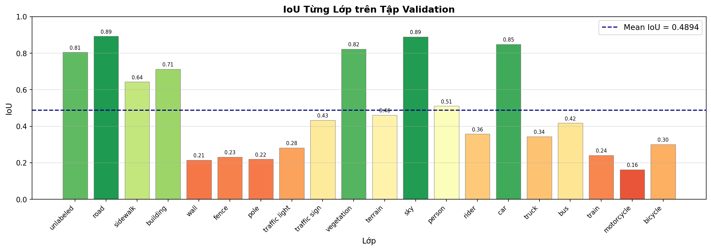
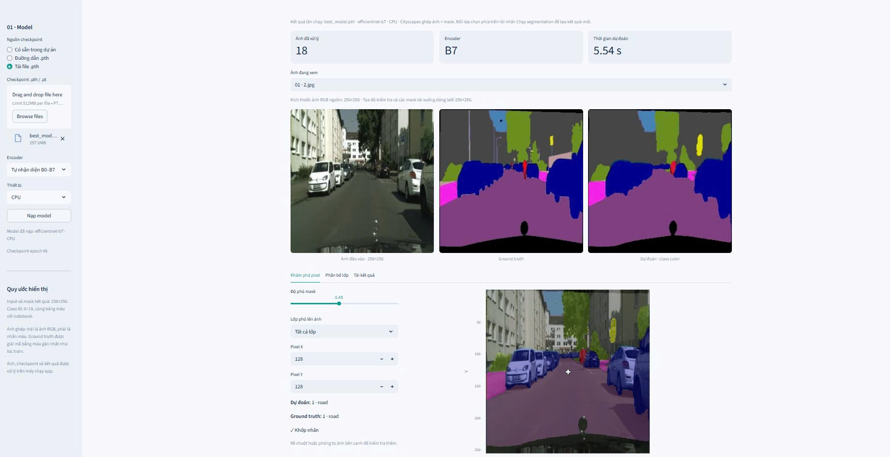
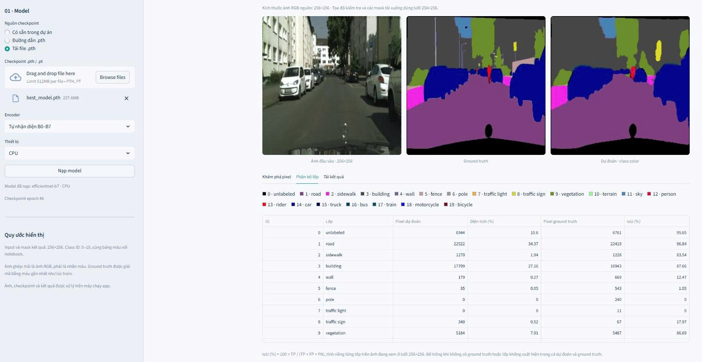
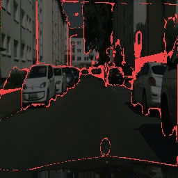

# Tiểu luận cuối kỳ môn học Deep Learning

## TRƯỜNG ĐẠI HỌC CÔNG NGHỆ KỸ THUẬT
##     THÀNH PHỐ HỒ CHÍ MINH

## Ứng dụng mạng EfficientNet vào bài toán phân đoạn ảnh giao thông sử dụng kiến trúc Encoder-Decoder

**Nhóm 9 — Trần Thanh Hùng — Nguyễn Xuân Lâm**
**Giáo viên hướng dẫn: PGS.TS Hoàng Văn Dũng**
Dự án sử dụng kiến trúc U-Net với encoder EfficientNet B0–B7 để phân đoạn ngữ nghĩa ảnh giao thông Cityscapes. Mỗi pixel được gán một nhãn lớp; ứng dụng Streamlit hỗ trợ nạp checkpoint, dự đoán trên một hoặc nhiều ảnh và đối chiếu với ground truth.

## 1. Notebook và tài nguyên

| Nội dung | Liên kết |
| --- | --- |
| Notebook huấn luyện trên Kaggle | [U-Net EfficientNet B0–B7](https://www.kaggle.com/code/hungtrandev99/unet-efficientnetb0-7) |
| Giao diện đánh giá mô hình | [Mở ứng dụng Streamlit](https://nhom9-efficientnet-unet.streamlit.app/) |
| Kết quả huấn luyện EfficientNet B0–B7 | [Thư mục Google Drive](https://drive.google.com/drive/folders/1QJmUWcxEvyuQyWpkai5DJGF4K399JQlL?usp=sharing) |

Notebook là nơi thực hiện huấn luyện. Sau khi train, sử dụng checkpoint `best_model.pth` tương ứng để đánh giá trên giao diện web. Checkpoint cần khớp kiến trúc U-Net, encoder EfficientNet và bộ 20 lớp của dự án.

## 2. Hướng dẫn sử dụng giao diện Streamlit

Chuẩn bị file `best_model.pth` và ảnh kiểm thử trên máy, sau đó mở [ứng dụng](https://nhom9-efficientnet-unet.streamlit.app/).

1. **B1.** Chọn **Tải file .pth**, tải `best_model.pth` lên.
2. **B2.** Chọn **Tự nhận diện B0–B7**, rồi nhấn **Nạp model**.
3. **B3.** Tải ảnh kiểm thử, chọn đúng định dạng và nhấn **Chạy segmentation**.

Chọn **Cityscapes ghép ảnh + mask** nếu file gồm ảnh RGB bên trái và mask nhãn bên phải. Chọn **Ảnh RGB riêng** nếu chỉ có ảnh đầu vào. Có thể tải một hoặc nhiều ảnh PNG/JPG/JPEG, rồi chọn từng ảnh để xem kết quả.



*Giao diện đã nạp EfficientNet-B7, checkpoint epoch 46, với tùy chọn tự nhận diện encoder.*

## 3. Kết quả mô hình EfficientNet-B7

### 3.1. Kết quả huấn luyện

Các số liệu dưới đây được đối chiếu từ `training_history.csv` của lần chạy B7 gồm 50 epoch; đây là kết quả validation, không phải điểm trên tập test độc lập.

| Chỉ số | Giá trị |
| --- | ---: |
| Số epoch huấn luyện | 50 |
| Epoch có `val_iou` cao nhất | 46 |
| `val_iou` cao nhất trong log huấn luyện | **44,31%** |
| Pixel accuracy validation tại epoch 46 | **86,20%** |
| Validation loss tại epoch 46 | 0,4936 |
| `val_iou` tại epoch 50 | 44,06% |
| Pixel accuracy validation tại epoch 50 | 86,04% |


*Loss giảm nhanh ở giai đoạn đầu; về cuối, IoU train tiếp tục tăng trong khi IoU validation dao động quanh 44%. Chênh lệch này cho thấy cần tiếp tục đánh giá khả năng tổng quát hóa.*

### 3.2. IoU theo từng lớp



Biểu đồ đánh giá từng lớp được cung cấp ghi **Mean IoU = 0,4894 (48,94%)**. Đây là số liệu của biểu đồ đánh giá riêng, còn **44,31%** ở bảng trên là giá trị tốt nhất của cột `val_iou` trong lịch sử huấn luyện. Không dùng hai số này thay thế cho nhau khi chưa đối chiếu cách tổng hợp metric và cấu hình đánh giá.

Theo các giá trị làm tròn trên biểu đồ, mô hình nhận diện tốt các vùng lớn như road và sky (khoảng 89%), car (85%), vegetation (82%). Các lớp nhỏ hoặc khó như motorcycle (16%), wall (21%) và pole (22%) vẫn còn hạn chế.

### 3.3. Kết quả dự đoán trực quan


*Ba cột lần lượt là ảnh gốc, ground truth và prediction. Mô hình thể hiện được cấu trúc đường, công trình, cây xanh và xe; một số chi tiết nhỏ và ranh giới đối tượng còn khác nhãn chuẩn.*

## 4. Minh họa đánh giá bằng giao diện web

### 4.1. So sánh ảnh đầu vào, ground truth và dự đoán



Chọn ảnh trong danh sách kết quả để so sánh ảnh đầu vào, ground truth và mask dự đoán. Tab **Khám phá pixel** cho phép xem lớp phủ, điều chỉnh độ phủ mask và kiểm tra nhãn tại tọa độ pixel. Ảnh minh họa sử dụng encoder B7.

### 4.2. Phân bố lớp và IoU của ảnh đang xem



Tab **Phân bố lớp** hiển thị số pixel dự đoán, diện tích (%), số pixel ground truth và **IoU (%)** của từng lớp:

```text
IoU (%) = TP / (TP + FP + FN) × 100
```

- **TP:** pixel được dự đoán đúng thuộc lớp đang xét.
- **FP:** pixel bị dự đoán vào lớp đó nhưng ground truth thuộc lớp khác.
- **FN:** pixel ground truth thuộc lớp đó nhưng bị dự đoán sang lớp khác.

IoU trên giao diện được tính cho **ảnh đang xem** ở lưới 256 × 256. Ảnh RGB không có ground truth không tính được IoU; lớp vắng trong cả dự đoán và ground truth được để trống. Diện tích (%) biểu thị tỷ lệ pixel dự đoán của lớp trong ảnh. IoU từng ảnh không đại diện cho mIoU của toàn bộ tập validation.

### 4.3. Minh họa vùng sai khác với ground truth



*Ảnh minh họa làm nổi bật vùng sai khác, giúp quan sát các lỗi tại ranh giới và chi tiết nhỏ.*

## 5. Minh họa dữ liệu và tăng cường ảnh


*Ví dụ dữ liệu được cung cấp trong dự án: ảnh đầu vào, mask màu và mask class ID. Một số mẫu thể hiện biến đổi ảnh và vùng che khuất. Cấu hình tăng cường dữ liệu và DataLoader được trình bày trong notebook Kaggle.*

## 6. Kết quả huấn luyện B0–B7

Toàn bộ tài nguyên kết quả huấn luyện được chia sẻ tại [Google Drive — EfficientNet B0–B7](https://drive.google.com/drive/folders/1QJmUWcxEvyuQyWpkai5DJGF4K399JQlL?usp=sharing). Chọn checkpoint của biến thể cần kiểm thử, tải về máy rồi thực hiện ba bước nạp model và chạy segmentation ở phần 2.

Nhánh mặc định của repo dùng để giới thiệu dự án và lưu ảnh minh họa. Nhánh `main` được giữ nguyên để phục vụ website Streamlit hiện có.
