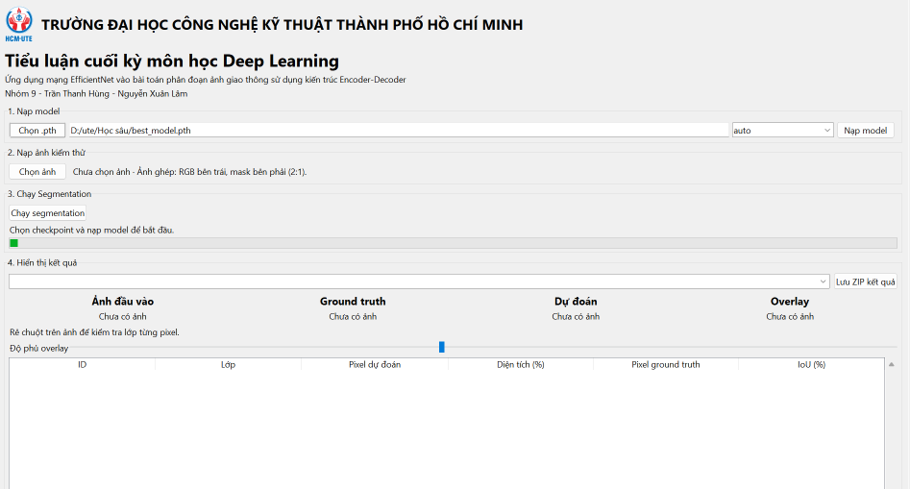
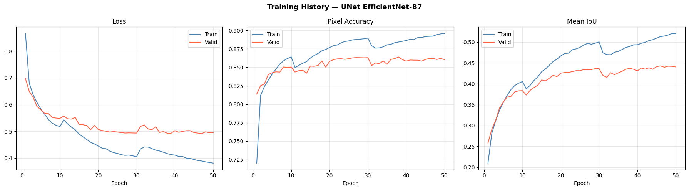
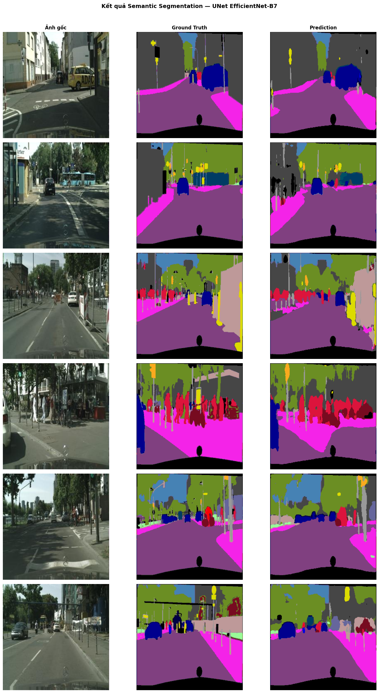
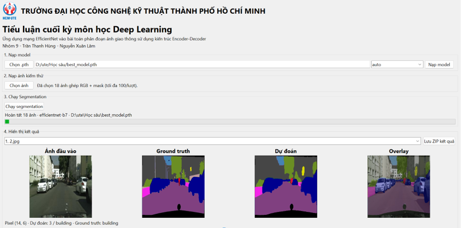
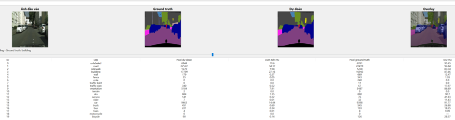
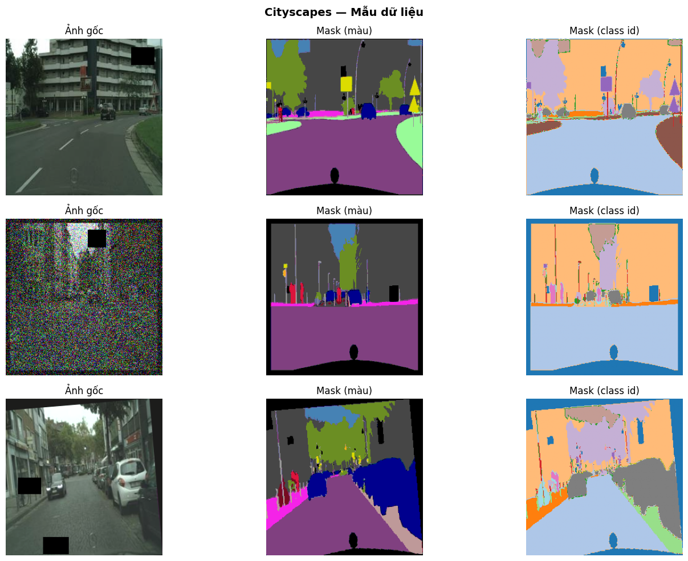

## TRƯỜNG ĐẠI HỌC CÔNG NGHỆ KỸ THUẬT THÀNH PHỐ HỒ CHÍ MINH

# Tiểu luận cuối kỳ môn học Deep Learning

## Ứng dụng mạng EfficientNet vào bài toán phân đoạn ảnh giao thông sử dụng kiến trúc Encoder-Decoder

Nhóm 9 — Trần Thanh Hùng — Nguyễn Xuân Lâm | Giáo viên hướng dẫn: PGS.TS Hoàng Văn Dũng

Dự án sử dụng kiến trúc U-Net với encoder EfficientNet B0–B7 để phân đoạn ngữ nghĩa ảnh giao thông Cityscapes. Mỗi pixel được gán một nhãn lớp; ứng dụng desktop hỗ trợ nạp checkpoint, dự đoán trên một hoặc nhiều ảnh và đối chiếu với ground truth.

## 1. Notebook và tài nguyên

| Nội dung | Liên kết |
| --- | --- |
| Notebook huấn luyện trên Kaggle | [U-Net EfficientNet B0–B7](https://www.kaggle.com/code/hungtrandev99/unet-efficientnetb0-7) |
| Giao diện đánh giá mô hình | Ứng dụng desktop Windows — xem hướng dẫn ở mục 2 |
| Kết quả huấn luyện EfficientNet B0–B7 | [Thư mục Google Drive](https://drive.google.com/drive/folders/1QJmUWcxEvyuQyWpkai5DJGF4K399JQlL?usp=sharing) |

Notebook là nơi thực hiện huấn luyện. Sau khi train, sử dụng checkpoint `best_model.pth` tương ứng để đánh giá trên giao diện desktop. Checkpoint cần khớp kiến trúc U-Net, encoder EfficientNet và bộ 20 lớp của dự án.

## 2. Hướng dẫn sử dụng giao diện desktop

Ứng dụng desktop được xây dựng bằng **Tkinter**, chạy trực tiếp trên Windows. Chuẩn bị bản đóng gói ứng dụng, checkpoint `best_model.pth` và các ảnh kiểm thử.

**Mở ứng dụng:** chạy `UNetEfficientNetDesktop.exe` trong thư mục bản đóng gói. Giữ thư mục `_internal` bên cạnh file `.exe`; khi chuyển sang máy khác, sao chép toàn bộ thư mục ứng dụng. Bản đóng gói không yêu cầu cài Python; checkpoint được chọn riêng từ máy người dùng.

Thực hiện theo **4 bước** trên giao diện:

1. **Nạp model:** nhấn **Chọn .pth**, chọn `best_model.pth`; giữ encoder **auto** để tự nhận diện EfficientNet B0–B7 hoặc chọn đúng biến thể, rồi nhấn **Nạp model**.
2. **Nạp ảnh kiểm thử:** nhấn **Chọn ảnh**, chọn một hoặc nhiều ảnh PNG/JPG/JPEG. Ứng dụng luôn sử dụng **ảnh ghép RGB bên trái + mask ground truth bên phải**, theo tỷ lệ **2:1**, tối đa **100 ảnh/lượt**.
3. **Chạy Segmentation:** nhấn **Chạy segmentation**, chờ thanh tiến trình và thông báo hoàn tất.
4. **Hiển thị kết quả:** chọn ảnh trong danh sách để xem **Ảnh đầu vào**, **Ground truth**, **Dự đoán** và **Overlay**; xem bảng IoU từng lớp bên dưới. Rê chuột trên ảnh để kiểm tra nhãn pixel, điều chỉnh **Độ phủ overlay** và nhấn **Lưu ZIP kết quả** nếu cần xuất kết quả.



*Giao diện desktop của Nhóm 9, gồm logo trường và bốn bước thao tác.*

Ứng dụng hiện xử lý trên **CPU**, với lưới dự đoán **256 × 256**. Model phải khớp kiến trúc U-Net EfficientNet B0–B7 và bảng 20 lớp của dự án. Khi đổi checkpoint, cần nạp model rồi chạy segmentation lại; kết quả đang hiển thị vẫn thuộc lượt chạy trước đó.

## 3. Kết quả mô hình EfficientNet-B7

### 3.1. Kết quả huấn luyện

Các số liệu dưới đây được đối chiếu từ `training_history.csv` của lần chạy B7 gồm 50 epoch; đây là kết quả validation, không phải điểm trên tập test độc lập.

| Chỉ số | Giá trị |
| --- | ---: |
| Số epoch huấn luyện | 50 |
| Epoch có `val_iou` cao nhất | 46 |
| `val_iou` cao nhất trong log huấn luyện | **44,31%** |
| Pixel accuracy validation tại epoch 46 | **86,20%** |
| Validation loss tại epoch 46 | 0,4936 |
| `val_iou` tại epoch 50 | 44,06% |
| Pixel accuracy validation tại epoch 50 | 86,04% |



*Loss giảm nhanh ở giai đoạn đầu; về cuối, IoU train tiếp tục tăng trong khi IoU validation dao động quanh 44%. Chênh lệch này cho thấy cần tiếp tục đánh giá khả năng tổng quát hóa.*

### 3.2. IoU theo từng lớp


Biểu đồ đánh giá từng lớp được cung cấp ghi **Mean IoU = 0,4894 (48,94%)**. Đây là số liệu của biểu đồ đánh giá riêng, còn **44,31%** ở bảng trên là giá trị tốt nhất của cột `val_iou` trong lịch sử huấn luyện. Không dùng hai số này thay thế cho nhau khi chưa đối chiếu cách tổng hợp metric và cấu hình đánh giá.

Theo các giá trị làm tròn trên biểu đồ, mô hình nhận diện tốt các vùng lớn như road và sky (khoảng 89%), car (85%), vegetation (82%). Các lớp nhỏ hoặc khó như motorcycle (16%), wall (21%) và pole (22%) vẫn còn hạn chế.

### 3.3. Kết quả dự đoán trực quan



*Ba cột lần lượt là ảnh gốc, ground truth và prediction. Mô hình thể hiện được cấu trúc đường, công trình, cây xanh và xe; một số chi tiết nhỏ và ranh giới đối tượng còn khác nhãn chuẩn.*

## 4. Minh họa đánh giá bằng giao diện desktop

### 4.1. So sánh ảnh đầu vào, ground truth và dự đoán



Chọn ảnh trong danh sách kết quả để so sánh ảnh đầu vào, ground truth và mask dự đoán. Bốn vùng ảnh hiển thị đồng thời ảnh RGB, ground truth, dự đoán và overlay. Có thể điều chỉnh độ phủ overlay và rê chuột trên ảnh để kiểm tra nhãn từng pixel. Ảnh minh họa sử dụng encoder B7.

### 4.2. Phân bố lớp và IoU của ảnh đang xem



Bảng thống kê bên dưới các ảnh hiển thị số pixel dự đoán, diện tích (%), số pixel ground truth và **IoU (%)** của từng lớp:

```text
IoU (%) = TP / (TP + FP + FN) × 100
```

- **TP:** pixel được dự đoán đúng thuộc lớp đang xét.
- **FP:** pixel bị dự đoán vào lớp đó nhưng ground truth thuộc lớp khác.
- **FN:** pixel ground truth thuộc lớp đó nhưng bị dự đoán sang lớp khác.

IoU trên giao diện được tính cho **ảnh đang xem** ở lưới 256 × 256. Ứng dụng lấy ground truth từ nửa mask của ảnh ghép; lớp vắng trong cả dự đoán và ground truth được hiển thị bằng dấu gạch ngang. Diện tích (%) biểu thị tỷ lệ pixel dự đoán của lớp trong ảnh. IoU từng ảnh không đại diện cho mIoU của toàn bộ tập validation.

### 4.3. Lưu kết quả đánh giá

Nhấn **Lưu ZIP kết quả** để xuất toàn bộ lượt chạy, gồm ảnh đầu vào, mask dự đoán, overlay, ground truth, ảnh đánh dấu vùng sai khác và bảng `class_pixels.csv` có IoU từng lớp. Các tệp này hỗ trợ lưu minh chứng và so sánh kết quả giữa các checkpoint.

Các ảnh minh họa desktop ở mục 2 và mục 4 được lấy từ thư mục `UNet_EfficientNet_Desktop/sample_images/` của dự án và lưu tại [sample_images](sample_images/) trong repo này.

## 5. Minh họa dữ liệu và tăng cường ảnh



*Ví dụ dữ liệu được cung cấp trong dự án: ảnh đầu vào, mask màu và mask class ID. Một số mẫu thể hiện biến đổi ảnh và vùng che khuất. Cấu hình tăng cường dữ liệu và DataLoader được trình bày trong notebook Kaggle.*

## 6. Kết quả huấn luyện B0–B7

Toàn bộ tài nguyên kết quả huấn luyện được chia sẻ tại [Google Drive — EfficientNet B0–B7](https://drive.google.com/drive/folders/1QJmUWcxEvyuQyWpkai5DJGF4K399JQlL?usp=sharing). Chọn checkpoint của biến thể cần kiểm thử, tải về máy rồi thực hiện bốn bước sử dụng giao diện desktop ở phần 2.

Nhánh mặc định của repo dùng để giới thiệu dự án, hướng dẫn sử dụng ứng dụng desktop và lưu ảnh minh họa.
